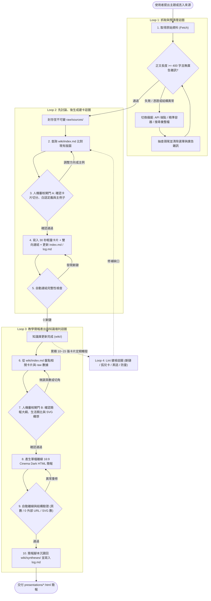
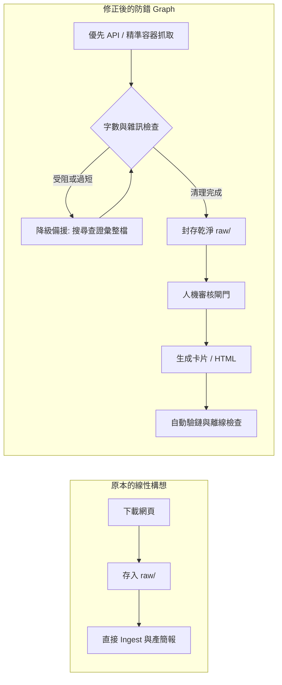

## 1. 系統整體 Graph（三層架構＋雙審核閘門）

本系統依據 [Agent.md](./Agent.md) 建立三層分離架構：**不可變原始來源層（`raw/`）** → **LLM 維護知識層（`wiki/`）** → **教學簡報輸出層（`presentations/`）**，並透過「人機審核閘門」與「自動化驗證節點」控制品質。

---

## 2. 四大重複執行的迴圈（Loops）

| 迴圈名稱 | 觸發時機 | 重複執行的節點 | 核心目的 |
| :--- | :--- | :--- | :--- |
| **Loop 1：Fetch & Sanitize（抓取與預清理）** | 每次從外部網站蒐集新資料時 | 抓取 → 檢查字數與雜訊 → 失敗時切換 API／換容器／彙整檔 → 清理重檢 | 擋下髒資料，確保進到 `raw/sources/` 的資料乾淨且可長期追溯。 |
| **Loop 2：Ingest（先討論、後生成建卡）** | 每新增 1 篇或多篇 `raw/` 來源時 | 讀 `index.md` → 人機審核提案 → 寫 30 秒輕量卡片＋雙向連結 → 自動驗鏈 → 寫 `log.md` | 避免 AI 自行暴走亂寫，確保每張卡片符合「去黑話、無劇透、30 秒可讀」標準。 |
| **Loop 3：Export Slide（教學簡報產出與複利）** | 需要針對特定主題對外教學或分享時 | 讀 `index.md` 抽卡片 → 審核簡報大綱 → 生成單檔 `.html` → 離線驗證 → 回寫 `wiki/syntheses/` | 將精簡卡片展開為大眾聽得懂的情境故事，同時讓簡報脈絡反饋回 Wiki 形成複利。 |
| **Loop 4：Lint（定期知識庫健檢）** | 每累積 10～15 張卡片或使用者手動觸發 | 全站掃描斷鏈、孤兒卡、字數超標、未解釋黑話、防雷缺漏 → 提出補強清單 | 防止知識庫隨規模擴大而腐化，維持高連結密度與一致風格。 |

---

## 3. 檢查點與重新生成機制（Checkpoints & Gates）

系統共設置 **5 個明確的檢查節點**（2 道人工決策閘門＋3 道程式／規則驗證）：

| 檢查節點 | 類型 | 檢查內容與通過標準 | 未通過時的處理（重新生成／退回） |
| :--- | :--- | :--- | :--- |
| **Gate 0：進 `raw/` 前預檢** | 程式＋人工抽查 | 正文 ≥ 400 字、無大量選單／廣告／空白 Tab、保留原始 URL 與擷取日期。 | 切換結構化 API（如 MediaWiki API）、改抓主文容器（如 `.meat`），或整併查證為研究總整理檔並手動清噪。 |
| **Gate A：建卡前提案審核** | 人機協作（必經） | 確認預計新增的卡片清單、一句話白話定義、主要舉例（如指定以《無職轉生》貫穿）與無劇透設計。 | 依使用者回饋調整卡片切分或改換舉例，**確認前絕不寫入 `wiki/`**。 |
| **Check 1：建卡後連結驗證** | 自動化腳本 | 掃描 `wiki/` 所有相對路徑 Markdown 連結（含跨卡關聯與 `raw/` 出處），須為 `0` 斷鏈。 | 自動定位斷鏈檔案與行號並修正，重新跑驗證直到 `BROKEN: []`。 |
| **Gate B：簡報前腳本審核** | 人機協作（必經） | 確認受眾設定、10 頁故事節奏、生活類比切角與每頁原創 SVG 圖解構想。 | 調整頁數、順序或敘事重點，**確認前絕不開始寫大量 HTML/CSS/SVG**。 |
| **Check 2：簡報後離線驗證** | 自動化腳本 | 驗證投影片總頁數符合大綱（`10` 頁）、外部 `http(s)://` 依賴為 `0`、內嵌 `<svg>` 正常存在（`12` 組）。 | 移除誤植的外部資源或補齊缺漏頁面，重新驗證後才交付。 |

---

## 4. 為什麼這樣設計？（核心設計理由）

1. **「輕卡片、重簡報」的關注點分離**
   - Wiki 卡片刻意壓在 **30 秒懶人包**（定義＋1 個最有感例子＋簡報點子），讓知識庫好檢索、好維護、不會淪為冗長筆記堆。
   - 針對普羅大眾的「職場／日常類比、幽默破冰、原創 SVG 圖解與 `S` 鍵口播稿」則集中在簡報階段展開，同一批卡片未來也能重組成不同受眾版本。
2. **把「低成本討論」放在「高成本生成」前面**
   - 一次建 6 張互連卡片或寫一份 ~73KB 的單檔互動 HTML 成本很高；把確認點前移到「表格提案」與「10 頁大綱」，可幾乎消除寫完才大幅返工的浪費。
3. **以 `index.md` 取代重型 RAG，以 `syntheses/` 實現知識複利**
   - 每次提問或做簡報都先讀 `wiki/index.md` 掌握全域版圖，再精準讀取相關卡片與 `raw/` 數據；產出的簡報脈絡再沉澱回 `wiki/syntheses/`，知識越用越厚實。

---

## 5. 實際執行後的反思與 Workflow 修正

在完成本專案「日本異世界題材動畫與漫畫風格演進（以《無職轉生》為主軸）」的完整端到端實作後，針對實際踩到的問題進行以下反思：

### 5.1 哪一個節點最常出錯？
**「節點 1：外部資料取得與格式清理（Fetch & Parse）」最常出錯。**

本次實際發生的錯誤案例包括：
- **環境與憑證限制**：預設沙盒無外網連線；切出沙盒後，Wikipedia 與 Real Sound 因本機系統時間（`2026-11-21`）與短期 TLS 憑證效期不符而被驗證阻擋；NYPL 因網頁結構差異抽取出 `0` 字元。
- **HTML 抓取雜訊污染**：成功下載的 Anime News Network（地區下拉選單）、關鍵評論網（會員廣告與延伸閱讀標籤雲）與萌娘百科（大量空白 Tab 排版行）皆夾帶非正文雜訊，若直接 Ingest 會干擾知識提煉品質。

### 5.2 發現問題後，把檢查往前移到了哪一個步驟？
1. **將「來源乾淨度與可用性檢查」前移至 `raw/sources/` 封存之前（Ingest 之前）**：
   - 不再假設抓取腳本輸出就能直接入庫，而是在抓取時先驗證最低字數門檻，並於封存前用 `read_file` 抽查文章頭尾、切除選單與廣告，確保「進入 `raw/` 即是乾淨事實來源」。
2. **將「核心例子與受眾切角對齊」前移至寫卡與寫 HTML 之前的審核閘門**：
   - 當使用者指定加入萌娘百科並「以《無職轉生》為主要例子」時，因為檢查設在寫入 `wiki/` 之前，得以在提案階段一次性把 6 張卡片與後續 10 頁簡報全部對齊同一主軸，零重工。

### 5.3 有沒有因此修改 Workflow / Graph？為什麼？
**有。** 原本的構想是線性的「搜尋下載 → 直接進 `raw/` → Ingest」，實測發現資料取得是最不穩定的環節，因此將第一步改造成**「多層降級備援＋進料前去雜訊子迴圈（Fetch & Sanitize Loop）」**，並在寫卡與產簡報之後補上自動化腳本驗證：

**修改原因**：與其在生成簡報後才發現「引用了廣告廢話」、「連結斷掉」或「外連圖片失效」，不如把容錯與驗證前置到資料入口與每次寫入的出口，讓整條管線在擴充下一個動漫主題時能穩定復用。

---

